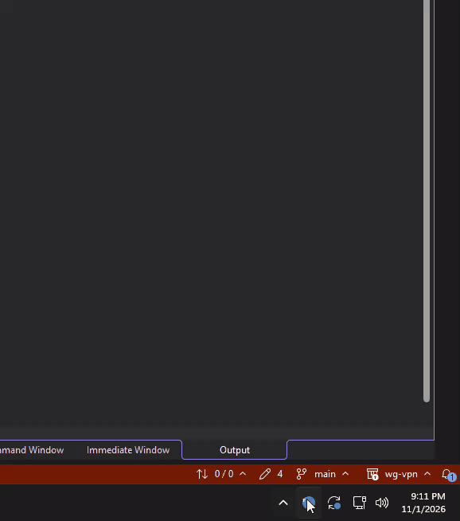

# WG-Client

A Windows VPN client that signs users in with Microsoft Entra ID, enrolls the device with a coordination API, and routes its internet traffic through a self-hosted WireGuard exit node.

**This is an educational project and isn't intended for production use.**

Importing a connection, signing in with Microsoft Entra ID, and connecting. The public IP changes from the home network to the VPN server.

## Highlights

- **Entra ID sign-in:** MSAL with the Windows broker (WAM), with users authorized by an app role.
- **Privilege separation:** the UI runs as the signed-in user, while a separate Windows service owns the tunnel and routing.
- **Named pipe IPC:** HTTP over a Windows named pipe with an explicit security descriptor.
- **Full-tunnel routing:** WireGuard's socket is bound to the physical adapter to prevent routing loops, and rebinds when the default route changes.
- **Automatic enrollment:** API validates the Entra token, assigns a tunnel IP, and registers the device as a WireGuard peer.
- **Automatic TLS:** API gets its SSL/TLS cert from Let's Encrypt and auto renews via ACME.

## Repository layout

| Path | Description | Stack |
| --- | --- | --- |
| [`WG-Client/`](WG-Client) | Desktop app, core library, and tests | C#, .NET 10, WinUI 3, MSAL, xUnit |
| [`wireguard-winservice/`](wireguard-winservice) | Windows service that runs the tunnel | Go, wireguard-go, Wintun, go-winio |
| [`wireguard-api/`](wireguard-api) | Linux API that enrolls devices as peers | Go, wgctrl, go-oidc, autocert |

## Design

- **Private keys stay on the device.** The service generates each key pair and only sends the public key to the API.
- **Tokens are fully validated.** The API checks the signature, issuer, audience, expiry, tenant, and the `Device.Enroll` app role.
- **Enrollment uses TLS by default** The API serves HTTPS, and the service verifies its certificate.

## Running it

This project needs a Microsoft Entra tenant, a Linux server running WireGuard, and a domain name, so it isn't a one-click install yet. 
A packaged client is planned.

## Current limitations and next steps
- Restrict the named pipe.
- Route IPv6 through the tunnel and set a DNS server.
- Remove old peers from the server.
- Automate M365 app setup.
- Package the client for easier installs.